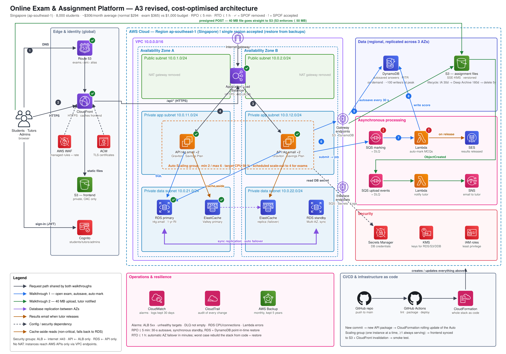

# Architecture: A3 revision

`architecture.svg` / `architecture.png` are the revised diagram (generated by `draw_a3.py`).
The three `lab-a3-*.json` files can be opened in the Cloud Architecture Lab (Export → Import workspace):

| File | What it is |
|---|---|
| `lab-a3-before-fix.json` | A3 design before the load-test fix (no cache): Analyze shows 2 HIGH bottlenecks |
| `lab-a3-final.json` | Final A3 design: no bottlenecks, F1–F4 all return 202 |
| `lab-a3-cache-spof.json` | Intermediate version with the cache in AZ-A only: AZ-A outage gives HTTP 503 |

## Change log vs A2

| # | A2 | A3 | Why (cost or test finding) | Effect |
|---|---|---|---|---|
| C1 | Region us-east-1 (Learner Lab) | **ap-southeast-1 Singapore** | Brief requires Singapore; it's also ~89 ms from Bhutan vs ~250 ms+ to us-east-1 | Prices went up ~10–20% per service, so the optimisations below matter more |
| C2 | 2 NAT gateways (one per AZ) | **No NAT.** Interface endpoints for SQS, Secrets Manager, CloudWatch Logs + the free S3/DynamoDB gateway endpoints | NAT was the 2nd most expensive line ($102.51/mo) and is pure overhead: the API only talks to AWS services | **−$38.17/mo.** Also removes the NAT as a per-AZ failure point. Packages come from AL2023 repos via the S3 endpoint; pip wheels are vendored in CI |
| C3 | t3.small, On-Demand | **t4g.small (Graviton/arm64) on a 1-yr Compute Savings Plan** | Same 2 vCPU / 2 GiB, cheaper per hour, and the base 2 instances run 24/7 so a commitment is safe | **−$16.20/mo** |
| C4 | RDS On-Demand | **db.t4g.small Multi-AZ, 1-yr Reserved Instance (no upfront)** | DB runs 24/7 for years; RI is a safe commitment | **−$15.84/mo** |
| C5 | Target tracking only (CPU 50%) | **+ scheduled scale-out to 4 instances on exam days** (`ExamPeriod=true`) | Load reasoning: ASG warm-up is 3–5 min but the exam-start burst lasts ~5 min, so reactive scaling arrives late | Extra 2 instances only during exam hours (+$10.21 in the exam month) |
| C6 | API reads straight from RDS | **ElastiCache Valkey (2 × cache.t4g.micro, Multi-AZ, cache-aside)** | Load test: Lab Analyze flagged *Database Connection & Throughput Contention* (HIGH) with 4+ API instances on one RDS | Bottleneck gone in re-test. +$28.03/mo. Cache is non-critical: on a miss/outage the API falls back to RDS |
| C7 | Cache in AZ-A only (intermediate A3 version) | **Primary + replica across both AZs** | Failure test: AZ-A outage returned **HTTP 503**. The cache had become a new SPOF | AZ-A outage now returns 202 |
| C8 | S3 lifecycle IA 30 d → Glacier Flexible 180 d | **IA 30 d → Glacier Deep Archive 180 d → delete at 5 y** | Old submissions are almost never read; Deep Archive is ~55% cheaper than Glacier Flexible | Cold storage cost more than halves as the 5-year archive grows |
| C9 | CloudWatch log groups kept forever | **30-day retention** | Logs were a hidden cost that grows every month | Log storage stays flat |
| C10 | Lambdas x86 | **arm64** | Cheaper per GB-second; no code changes needed for Python | Small, within free tier anyway |

## Single points of failure

✓ = removed, ! = accepted (marked the same way on the diagram)

| Component | Status | How |
|---|---|---|
| API instances | ✓ removed | 2 per AZ in an ASG behind the ALB (tested: F1, F4) |
| RDS | ✓ removed | Multi-AZ synchronous standby, automatic failover ~1–2 min (tested: F2) |
| ElastiCache | ✓ removed | Replica in AZ-B with auto failover, and the app works without it (C7) |
| NAT gateway | ✓ removed | No NAT at all (C2) |
| ALB, CloudFront, Route 53 | ✓ | AWS-managed, multi-AZ / global |
| SQS marking queue + marking Lambda | ! accepted | Regional managed services with no second copy. If they fail, auto-marking stops (tested: F3). Submissions are still saved because answers live in DynamoDB; fix = API writes `pending_marking` to RDS when `SendMessage` fails and a sweeper re-queues them |
| Single region | ! accepted | A second region would roughly double the bill. RTO 1 h is met by rebuilding from CloudFormation + restoring the latest backup |
