# DSO303 Assignment 3: Cost-optimised exam platform

**Repo:** https://github.com/TandinZangmo456/DSO303_A3_02230305
**Region:** ap-southeast-1 (Singapore)
**Pricing date:** 20 Nov 2026

## 1. What this assignment was about

In A2 I designed an AWS architecture for an online exam and assignment platform for 8,000 students. A3 asked me to take that design and:

1. **Price it properly** in the AWS Pricing Calculator for a normal month and an exam month, including the hidden costs.
2. **Compare services and regions**, then give a feasibility verdict against a $1,000/month budget, peak load, RPO ≤ 5 min and RTO ≤ 1 h.
3. **Test it** for load and failures in the Cloud Architecture Lab, and change the design based on what the tests showed.

The design I submitted is the result of those three steps. It isn't just the A2 diagram with prices added.

## 2. The revised architecture

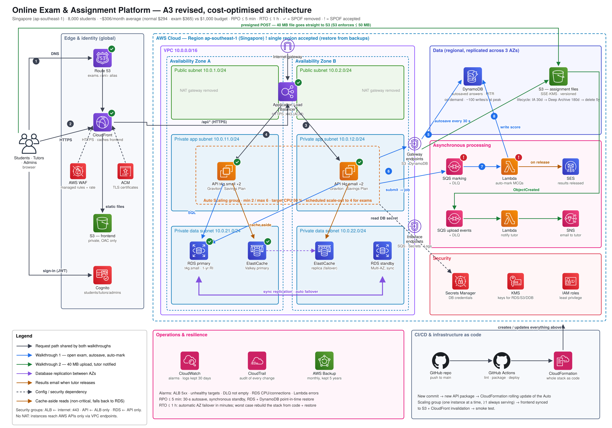

✓ = single point of failure removed, ! = single point of failure accepted.

### Main changes from A2

| Change | Why |
|---|---|
| Moved to **Singapore** | Required by the brief, and much closer to Bhutan than us-east-1 |
| **Removed both NAT gateways** and used VPC endpoints instead | NAT cost $102.51/month just so the instances could reach AWS APIs. Endpoints cost $64.34 |
| **t3.small → t4g.small (Graviton)** on a 1-year Savings Plan | Same size but cheaper. The 2 base instances run 24/7, so committing is safe |
| **RDS on a 1-year Reserved Instance** | The database also runs 24/7 |
| **Scheduled scale-out to 4 instances** on exam days | Auto Scaling takes 3–5 min to react, but the exam-start rush lasts about 5 min |
| **Added ElastiCache** (Valkey, 2 nodes across both AZs) | The load test showed RDS as a bottleneck (section 5) |
| S3 lifecycle to **Glacier Deep Archive** after 180 days | Old submissions are rarely read; Deep Archive is about 55% cheaper than Glacier Flexible |
| **30-day log retention** | Stops CloudWatch Logs from growing forever |

### Single points of failure

| Component | Status |
|---|---|
| API instances, RDS, ElastiCache, NAT | Removed: 2 AZs, Multi-AZ, replica, or not used at all |
| SQS marking queue + marking Lambda | **Accepted.** If they fail, marking is delayed but submissions are still saved |
| Single region | **Accepted.** A second region would roughly double the cost. Recovery is a CloudFormation rebuild plus restoring backups, within 1 hour |

The full change log is in `architecture/README.md`.

## 3. Cost estimate

I built two estimates in the AWS Pricing Calculator with all 19 services:

| Estimate | Monthly cost | Link |
|---|---:|---|
| Normal month | **$329.54** | [calculator](https://calculator.aws/#/estimate?id=0e5d0b19169add1da7f5e97aa9c832abd8cacac6) |
| Exam month | **$400.68** | [calculator](https://calculator.aws/#/estimate?id=f09315d41728e33373dc5162336f3b3267d24835) |

**Normal month:**

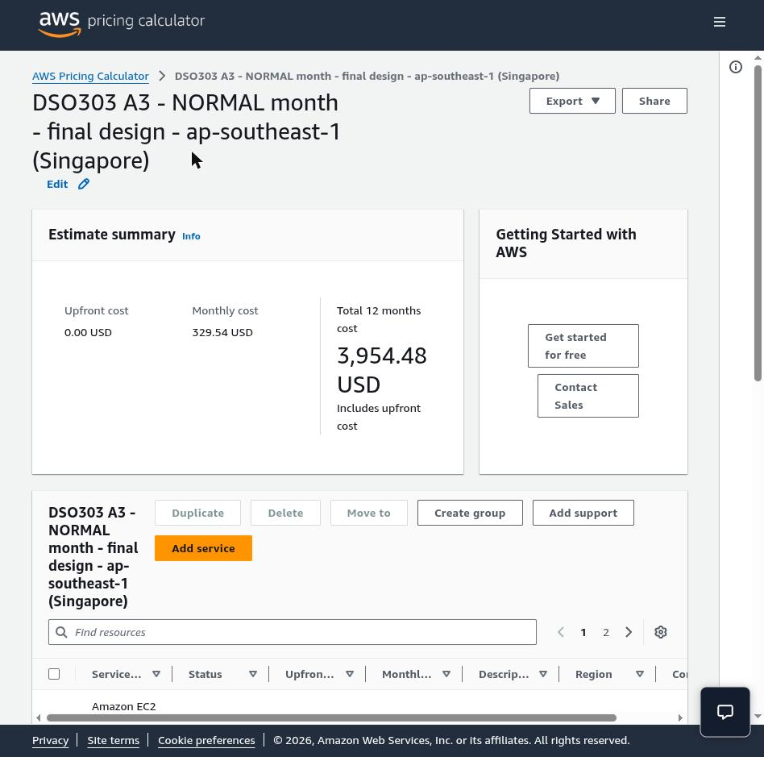

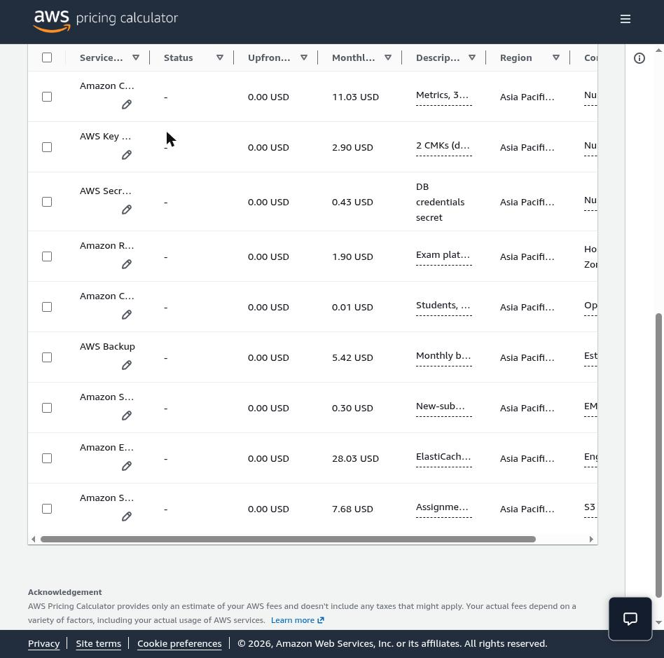

**Exam month.** Traffic goes up for CloudFront, WAF, DynamoDB autosaves and emails, and 2 extra EC2 instances run on exam days:

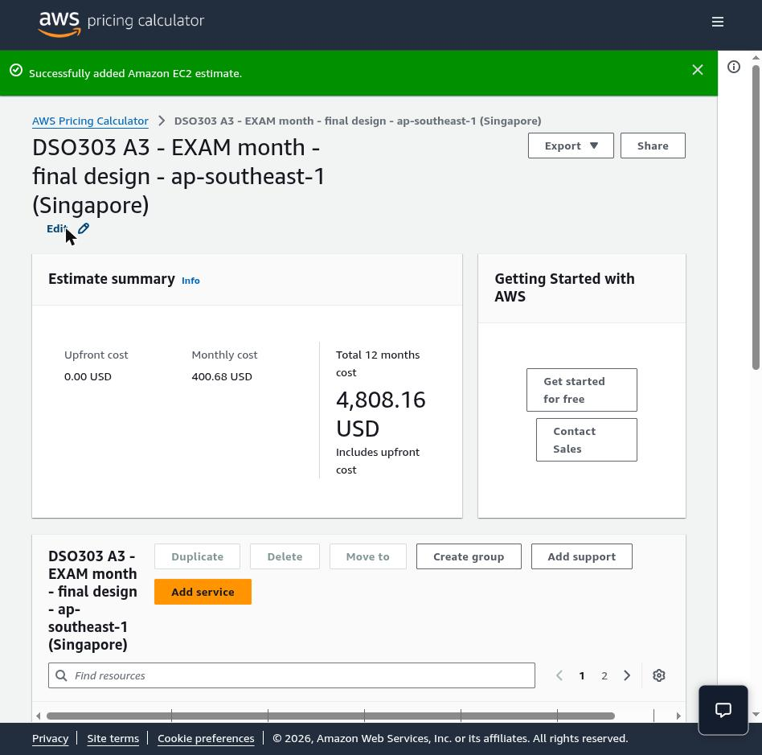
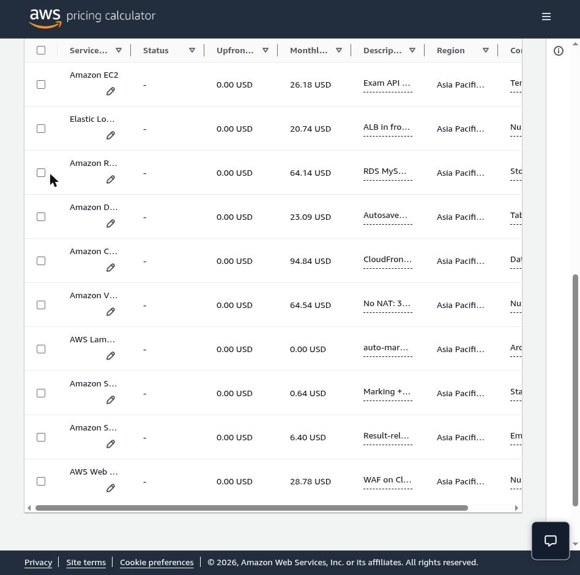

**Totals (10 normal months + 2 exam months):**

| | |
|---|---:|
| Annual | **$4,096.76** |
| Average per month | **$341.40** |
| Per student per year | **$0.51** |

**Top 3 costs:**

| Rank | Service | Normal month |
|---|---|---:|
| 1 | CloudFront | $71.03 |
| 2 | VPC endpoints | $64.34 |
| 3 | RDS | $64.14 |

Together these are about 60% of the bill.

**Hidden costs I accounted for:**
- data transfer out (inside CloudFront)
- NAT processing (removed)
- interface endpoint hours
- public IPv4 addresses
- CloudWatch Logs
- KMS requests
- backups, which will grow over the 5-year retention

## 4. Optimisations

The [optimisations estimate](https://calculator.aws/#/estimate?id=09198a2ce3d53ad6fb518815bb1050eae6e44783) compares the A2 design (BEFORE) with the A3 design (AFTER):

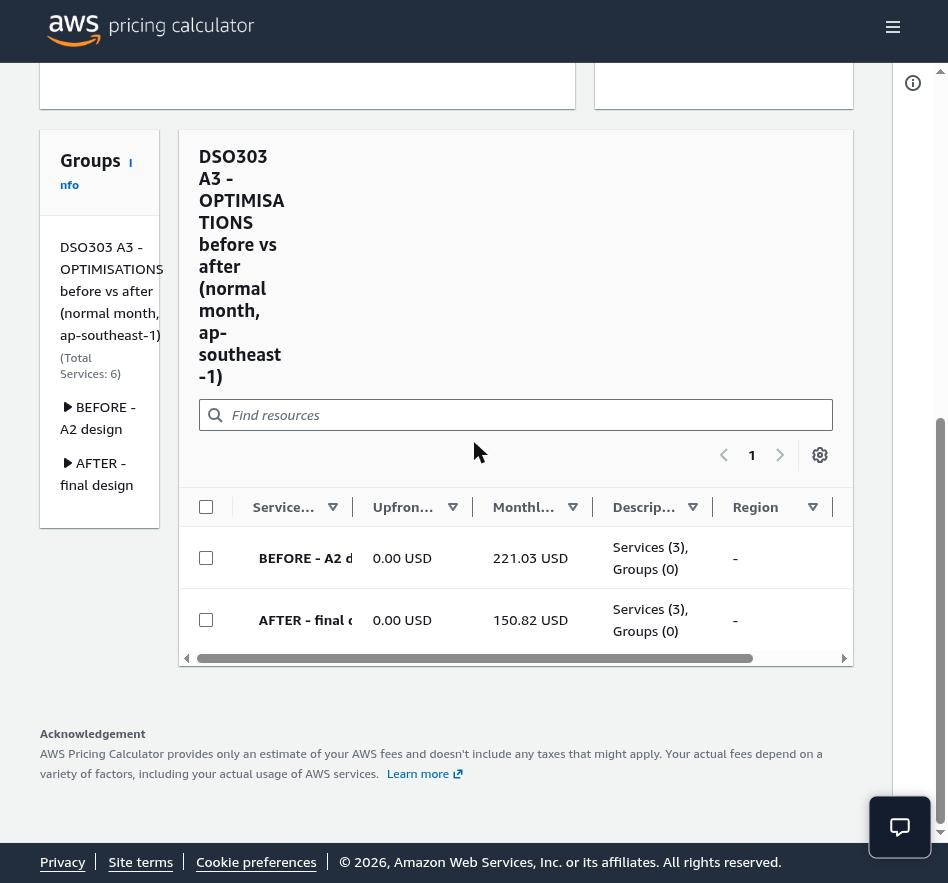

| Optimisation | Before | After | Saving/month |
|---|---:|---:|---:|
| NAT gateways → VPC endpoints | $102.51 | $64.34 | $38.17 |
| t3.small On-Demand → t4g.small + Savings Plan | $38.54 | $22.34 | $16.20 |
| RDS On-Demand → Reserved Instance | $79.98 | $64.14 | $15.84 |
| **Total** | **$221.03** | **$150.82** | **$70.21 (~$842/year)** |

**Service comparisons** (full tables in `docs/cost-report.md`):

| Choice | Picked | Why |
|---|---|---|
| EC2 vs Fargate vs Lambda | EC2 | ~$22 vs ~$72 vs ~$66/month for our always-on load |
| RDS vs Aurora Serverless v2 vs DynamoDB | RDS for relational data, DynamoDB for autosaves | Aurora's minimum capacity makes it cost more than the RDS RI at our load |
| NAT vs endpoints | Endpoints | Cheaper, as shown above |
| On-Demand vs Savings Plans / RIs | Commit only the 24/7 baseline | Exam-day instances run about 120 hours a month, so committing to 730 would waste money |
| S3 classes for 5-year retention | Deep Archive | About $8/month for 4 TB vs about $100 in S3 Standard |

**Region:** Mumbai is about 8% cheaper and measured 68 ms from Bhutan vs 89 ms for Singapore. I stayed in Singapore because the brief requires it and the difference is only about $26/month.

## 5. Load test

I ran the test in the Cloud Architecture Lab with `PUT /api/attempts/demo/answers` (a student saving an answer).

**Before the fix:** with 2 API instances per AZ all reading RDS directly, Analyze found **2 HIGH "Database Connection & Throughput Contention" bottlenecks**. Too many instances were opening connections to one database.

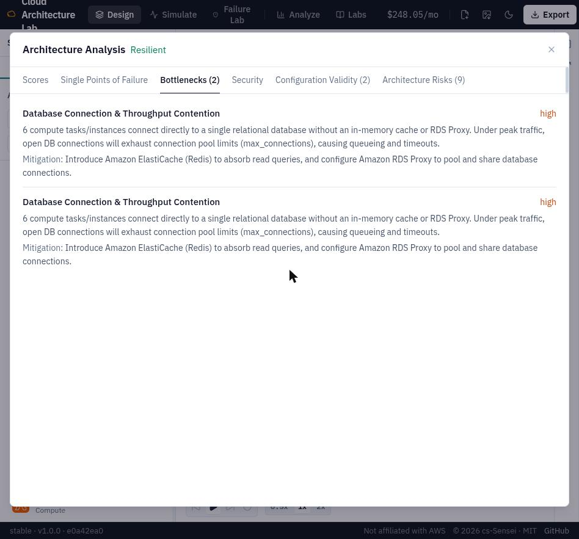
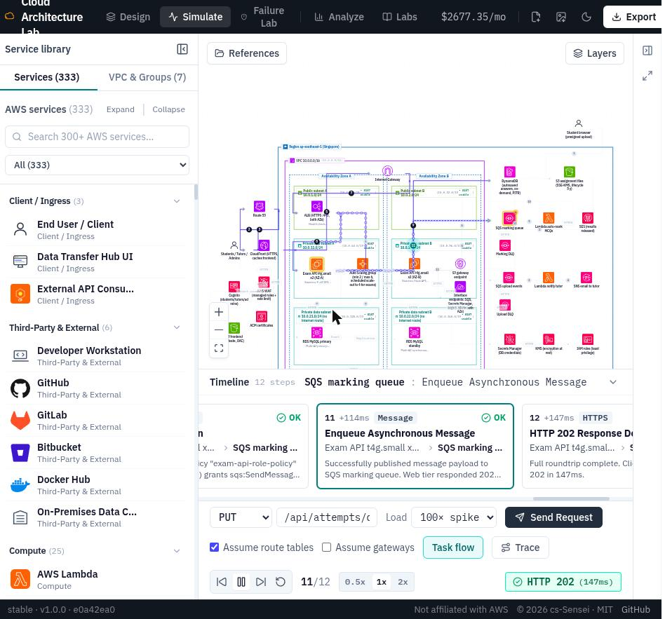

**Fix:** I added ElastiCache as a cache-aside layer for exam papers, which are read a lot but rarely change. If the cache is down, the API just reads from RDS.

**After the fix:** "No bottlenecks detected", and the 100× spike returns **HTTP 202 in 147 ms**.

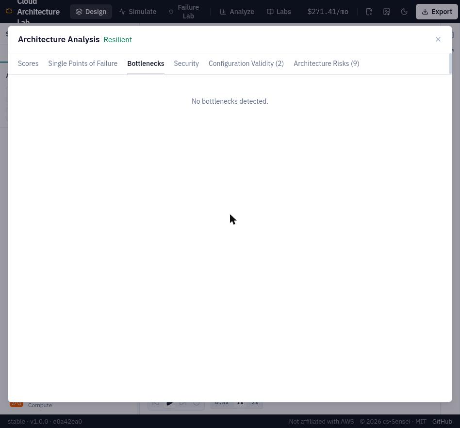
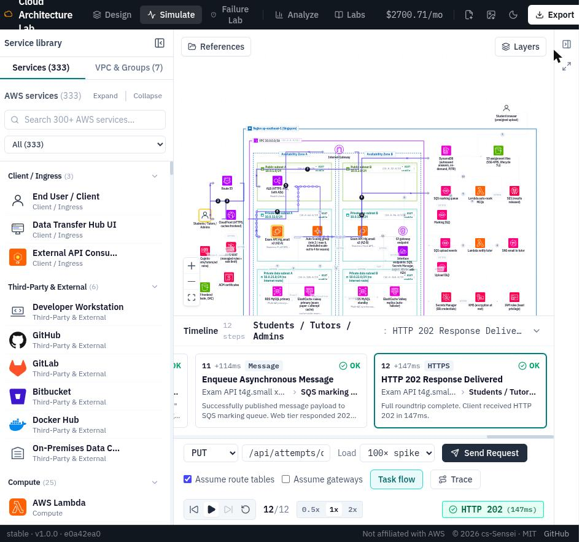

**How I'd prove it in real AWS:** the RDS `DatabaseConnections` and `CPUUtilization` metrics in CloudWatch, before and after.

**Two more bottlenecks (reasoned, not simulated):**
1. **Auto Scaling is too slow for the exam-start rush.** Fixed with scheduled scale-out.
2. **Marking backlog at the end of an exam.** The Lambda concurrency is capped at 5, so about 8,000 jobs take roughly 25–30 min to clear. That's acceptable because results are released later anyway.

## 6. Failure tests

| # | Scenario | Result | RPO | RTO |
|---|---|---|---|---|
| F1 | Whole AZ-A down | HTTP 202: 3 resources failed, 5 dependents survived | 0 | ~1–2 min |
| F2 | RDS primary fails | HTTP 202: standby takes over | 0 | ~2 min |
| F3 | Marking Lambda down | HTTP 202: submissions still work, marking is delayed | 0 | until fixed |
| F4 | Bad deployment on the AZ-A instances | HTTP 202: ALB health checks remove them | 0 | ~1 min |

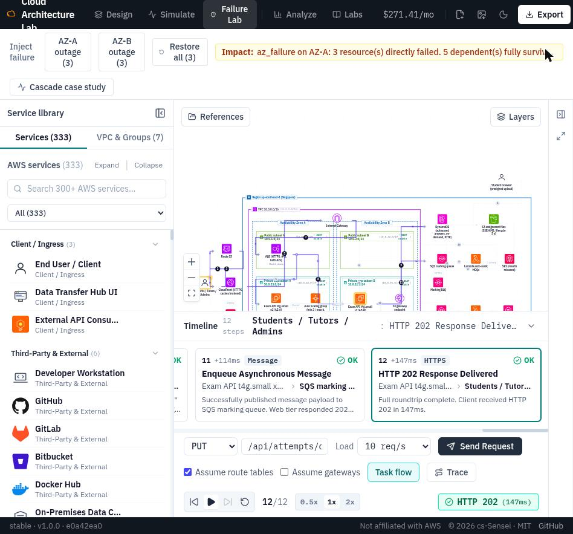
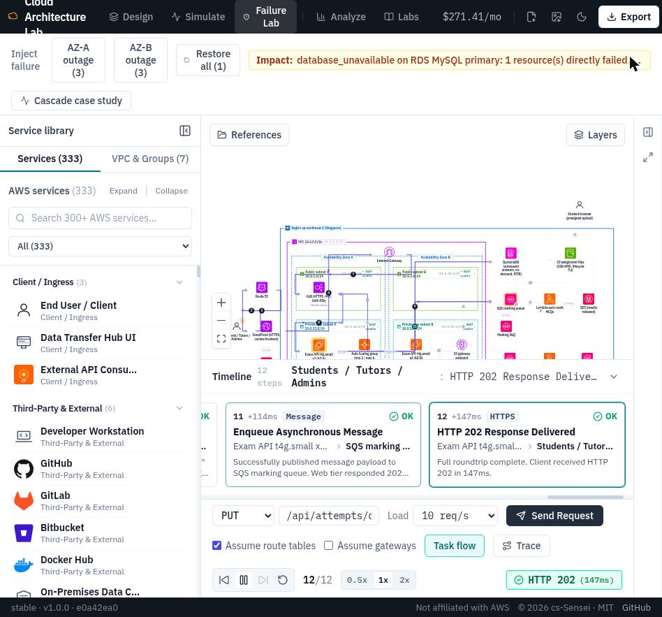
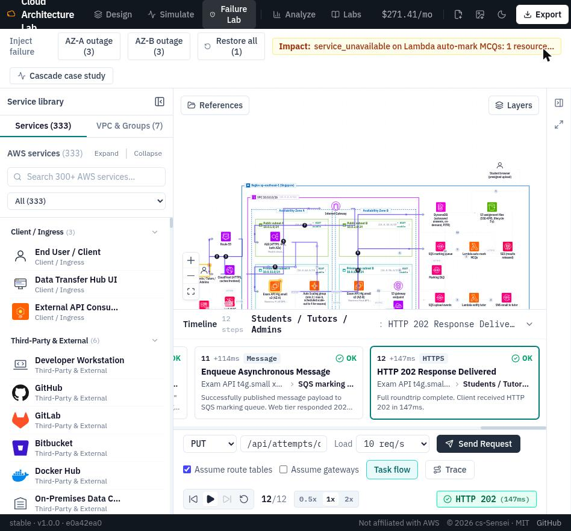

**The test that changed the design:** my first cache had a single node in AZ-A only. When I re-ran the AZ-A outage, the request **failed with HTTP 503**. The cache had become a new single point of failure. I fixed it by adding a replica in AZ-B and making the cache optional. After that, F1 passed again.

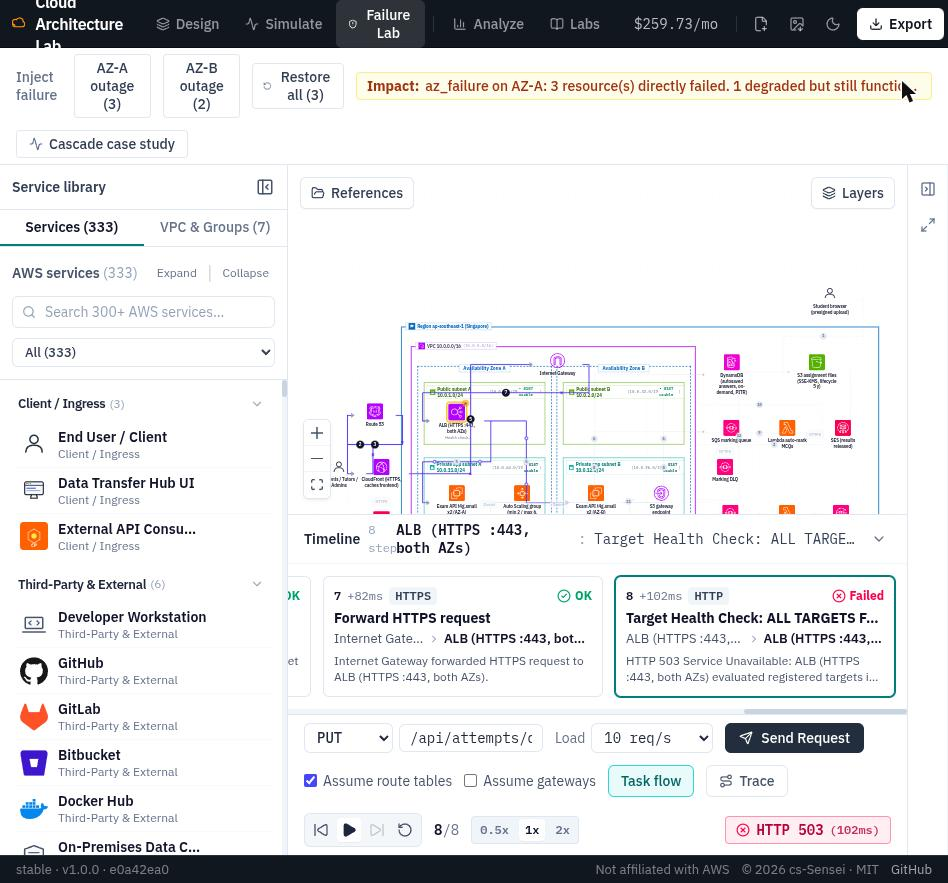

Expected impact, measured result and fixes for each scenario are in `infra/failure-tests.md`.

## 7. Feasibility verdict

| Requirement | Target | Result | |
|---|---|---|---|
| Budget | ≤ $1,000/month | $341.40 average, $400.68 in the worst month | ✅ |
| Peak load | 8,000 students at once | 202 in 147 ms at 100×, no bottlenecks | ✅ |
| RPO | ≤ 5 min | 0 for an AZ loss; point-in-time restore for corruption | ✅ |
| RTO | ≤ 1 h | ~2 min for an AZ loss; ~40–50 min for a full rebuild | ✅ |

**Feasible.** The design uses about a third of the budget and passed every test. The risks I accept are a full regional outage and a delay in auto-marking.

## 8. What I learned

- **The biggest saving wasn't compute.** It was removing NAT gateways, which I'd added in A2 without thinking about their cost. Hidden networking costs add up fast.
- **Fixing one problem can create another.** The cache fixed the bottleneck but added a new single point of failure. I only found it because I re-ran the failure tests after the change.
- **Only commit to what always runs.** Savings Plans and RIs work for the 24/7 baseline, while exam-day capacity is cheaper On-Demand.
